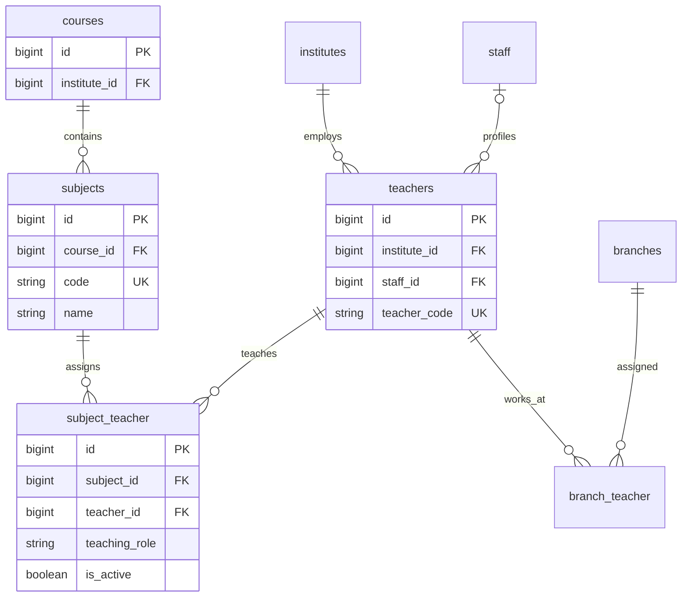

database
====================

4 core modules and table list
-------------------------------
CMUD serves one institute. The `institutes` table stores the single company profile (name, contact details, logo, TIN, and BIN); it is not a multi-tenant institute registry. Keep one institute profile row. Branches are locations belonging to this company.
1. Institute & Branches 
2. Students & Academy
3.Finance
4.User Aceess Management

For CMUD, follow this order for making the database
======================================================
1. Finalize the schema: tables, columns, primary keys, foreign keys, and relationship rules.
2. Create table migrations: include primary keys and reference columns such as student_id.
3. Create relationship migrations: add foreign key constraints after all referenced tables exist.
4. Create Eloquent models: define matching hasMany(), belongsTo(), and other relationships.
5. Run php artisan migrate: Laravel executes table migrations first, then relationship migrations,

PHP runtime security requirement
================================
PHP2Shell security update (CVE-2026-109618 and CVE-2026-109619): use a patched PHP runtime.
Recommended minimum for new deployments: PHP 8.5.12 or later.
If application compatibility requires an older supported branch, the minimum patched versions are:
- PHP 8.4.27
- PHP 8.3.36
- PHP 8.2.35 (security support ends 31 December 2026; plan to upgrade to a newer branch)

For Windows, use the latest official Windows build for the selected branch, including the
26 October 2026 Brotli security rebuild where available. Keep PHP updated to the latest patch
release on that branch. Upgrading this documented requirement does not update the PHP runtime
installed on a web server; update PHP in the hosting/container environment as well.

3 core foundations(table list)
-------------------------------

1. Institute & Branches 

Table 1.1 — institutes
| Column | Purpose |
|---|---|
| **`id` — PK** | Unique institute ID |
| `code` | Institute code |
| `name` | Institute name |
| `phone` | Main contact number |
| `email` | Official email address |
| `tin_number` | Company Taxpayer Identification Number (TIN), optional |
| `bin_number` | Business Identification Number (BIN), optional and unique |
| `website` | Website address, optional |
| `address` | Main office address |
| `logo_path` | Logo file location, optional |
| `is_active` | Whether the institute is active |
| `created_at` | Record creation time |
| `updated_at` | Last update time |

Foreign keys and relationships
Foreign keys stored in this table:
- None.
Relationships from this table:
- `branches.institute_id` -> `institutes.id` (1:N; one company profile has many branches).
- `departments.institute_id` -> `institutes.id` (1:N).
- `staff.institute_id` -> `institutes.id` (1:N).
- `asset_categories.institute_id` -> `institutes.id` (1:N).
- `students.institute_id` -> `institutes.id` (1:N).
- `courses.institute_id` -> `institutes.id` (1:N).
- `certificate_templates.institute_id` -> `institutes.id` (1:N).
- `communication_groups.institute_id` -> `institutes.id` (1:N).
- `teachers.institute_id` -> `institutes.id` (1:N).
- `student_expense_types.institute_id` -> `institutes.id` (1:N).
- `institute_expense_categories.institute_id` -> `institutes.id` (1:N).
- `payment_methods.institute_id` -> `institutes.id` (1:N).
- `financial_accounts.institute_id` -> `institutes.id` (1:N).

Table 1.2 — branches
| Column | Purpose |
|---|---|
| **`id` — PK** | Unique branch ID |
| `institute_id` | Institute this branch belongs to |
| `code` | Branch code |
| `name` | Branch name |
| `phone` | Branch contact number |
| `email` | Branch email address, optional |
| `address` | Branch address |
| `is_active` | Whether the branch is active |
| `created_at` | Record creation time |
| `updated_at` | Last update time |

Foreign keys and relationships
Foreign keys stored in this table:
- `institute_id` -> `institutes.id`.
Relationships from this table:
- `rooms.branch_id` -> `branches.id` (1:N).
- `branch_teacher.branch_id` -> `branches.id` (1:N).
- `staff_assignments.branch_id` -> `branches.id` (1:N).
- `assets.branch_id` -> `branches.id` (1:N).
- `students.admission_branch_id` -> `branches.id` (1:N).
- `batches.branch_id` -> `branches.id` (1:N).
- `enrollments.branch_id` -> `branches.id` (1:N).
- `communication_groups.branch_id` -> `branches.id` (1:N; optional).
- `student_expense_price_versions.branch_id` -> `branches.id` (1:N; optional).
- `course_price_versions.branch_id` -> `branches.id` (1:N; optional; branch-specific course fee override).
- `student_expenses.branch_id` -> `branches.id` (1:N).
- `institute_expense_price_versions.branch_id` -> `branches.id` (1:N; optional).
- `institute_expenses.branch_id` -> `branches.id` (1:N; optional).
- `financial_accounts.branch_id` -> `branches.id` (1:N; optional).
- `stocks.branch_id` -> `branches.id` (1:N).

Table 1.3 — departments
| Column | Purpose |
|---|---|
| **`id` — PK** | Unique department ID |
| `institute_id` | Institute this department belongs to |
| `code` | Department code |
| `name` | Department name |
| `description` | Department responsibilities, optional |
| `is_active` | Whether the department is active |
| `created_at` | Record creation time |
| `updated_at` | Last update time |

Foreign keys and relationships
Foreign keys stored in this table:
- `institute_id` -> `institutes.id`.
Relationships from this table:
- `staff_assignments.department_id` -> `departments.id` (1:N).
- `institute_expenses.department_id` -> `departments.id` (1:N; optional).

Table 1.4 — rooms
| Column | Purpose |
|---|---|
| **`id` PRIMARY KEY** | Unique room ID |
| `branch_id` | Branch containing the room |
| `code` | Room number or code |
| `name` | Room name |
| `room_type` | Classroom, laboratory, office, etc. |
| `floor` | Floor name or number, optional |
| `capacity` | Maximum number of students the room can hold; required and positive |
| `description` | Additional room details, optional |
| `is_active` | Whether the room is available for use |
| `created_at` | Record creation time |
| `updated_at` | Last update time |

Foreign keys and relationships
Foreign keys stored in this table:
- `branch_id` -> `branches.id`.
Relationships from this table:
- A branch has many rooms; each room belongs to exactly one branch (1:N).
- `assets.room_id` -> `rooms.id` (1:N; optional).

Capacity constraint
- `capacity` must be a positive integer representing student seats.

Table 1.5 — staff
| Column | Purpose |
|---|---|
| **`id` PRIMARY KEY** | Unique staff ID |
| `institute_id` | Institute employing the staff member |
| `user_id` | Optional login account linked to this staff member; unique |
| `staff_code` | Employee identification code |
| `full_name` | Staff member?s full name |
| `phone` | Contact number |
| `email` | Email address, optional |
| `nid_number` | National identity number, optional; stored as text |
| `address` | Address, optional |
| `date_of_birth` | Date of birth, optional |
| `photo_path` | Staff photo location, optional |
| `designation` | Job title |
| `joining_date` | Employment start date |
| `leaving_date` | Employment end date, optional |
| `employment_status` | Active, on leave, resigned, terminated, etc. |
| `notes` | Additional employment information, optional |
| `created_at` | Record creation time |
| `updated_at` | Last update time |

Foreign keys and relationships
Foreign keys stored in this table:
- `institute_id` -> `institutes.id`.
- `user_id` -> `users.id` (nullable; unique; set NULL if the user account is deleted).
Relationships from this table:
- `staff_assignments.staff_id` -> `staff.id` (1:N).
- `teachers.staff_id` -> `staff.id` (1:N; optional).
- `institute_expenses.staff_id` -> `staff.id` (1:N; optional).

Table 1.6 — staff_assignments
| Column | Purpose |
|---|---|
| **`id` PRIMARY KEY** | Staff assignment ID |
| `staff_id` | Staff member receiving the assignment |
| `branch_id` | Assigned branch |
| `department_id` | Assigned department |
| `created_at` | Record creation time |
| `updated_at` | Last update time |

Foreign keys and relationships
Foreign keys stored in this table:
- `staff_id` -> `staff.id`.
- `branch_id` -> `branches.id`.
- `department_id` -> `departments.id`.
Relationships from this table:
- No other table references this table.

Table 1.7 — asset_categories
| Column | Purpose |
|---|---|
| **`id` PRIMARY KEY** | Asset category ID |
| `institute_id` | Institute defining the category |
| `code` | Category code |
| `name` | Category name |
| `description` | Category details, optional |
| `is_active` | Whether the category is active |
| `created_at` | Record creation time |
| `updated_at` | Last update time |

Foreign keys and relationships
Foreign keys stored in this table:
- `institute_id` -> `institutes.id`.
Relationships from this table:
- `assets.asset_category_id` -> `asset_categories.id` (1:N).

Table 1.8 — assets
| Column | Purpose |
|---|---|
| **`id` — PK** | Unique asset ID |
| `asset_category_id` | Asset category |
| `branch_id` | Branch currently holding the asset |
| `room_id` | Current room, optional |
| `asset_code` | Internal asset identification code |
| `name` | Asset name |
| `brand` | Manufacturer or brand, optional |
| `model` | Model name or number, optional |
| `serial_number` | Manufacturer’s serial number, optional |
| `purchase_date` | Purchase date, optional |
| `purchase_cost` | Original acquisition cost; required and zero or greater |
| `unit` | Unit for this tracked asset, such as piece or set; required |
| `warranty_expires_on` | Warranty expiry date, optional |
| `condition` | Good, fair, damaged, etc. |
| `status` | In use, in storage, under maintenance, disposed, etc. |
| `notes` | Additional asset details, optional |
| `created_at` | Record creation time |
| `updated_at` | Last update time |

Foreign keys and relationships
Foreign keys stored in this table:
- `asset_category_id` -> `asset_categories.id`.
- `branch_id` -> `branches.id`.
- `room_id` -> `rooms.id` (nullable; optional).
Relationships from this table:
- `institute_expenses.asset_id` -> `assets.id` (1:N; optional).

Asset field constraints
- `purchase_cost` must be zero or greater and cannot be NULL. Zero may be used for donated assets.
- `unit` cannot be NULL and describes the tracked asset; it is separate from the consumable unit on `stocks`.

Asset purchase workflow
- For an individually tracked asset purchase, create an `assets` row and a corresponding `institute_expenses` row linked through `asset_id`.
- Record the money paid in `institute_expense_payments`.
- `assets.purchase_cost` is the asset-register value; expense and payment rows are the financial transaction. Reports must not count the asset-register value again as an expense.

Table 1.9 — stocks
| Column | Key / Details |
|---|---|
| `id` | Primary key |
| `branch_id` | Foreign key → `branches.id` |
| `item_code` | Item identification code |
| `item_name` | Name of the item |
| `unit` | Piece, box, ream, litre, etc. |
| `quantity_on_hand` | Decimal; default `0`; cannot be negative |
| `reorder_level` | Decimal; default `0`; low-stock alert threshold |
| `notes` | Nullable |
| `created_at` | Timestamp |
| `updated_at` | Timestamp |

Foreign keys and relationships
Foreign keys stored in this table:
- `branch_id` -> `branches.id`.
Relationships from this table:
- `stock_movements.stock_id` -> `stocks.id` (1:N).
- `stock_price_versions.stock_id` -> `stocks.id` (1:N).

Table 1.10 — stock_movements
| Column | Key / Details |
|---|---|
| `id` | Primary key |
| `stock_id` | Foreign key → `stocks.id` |
| `movement_type` | `in` or `out` |
| `quantity` | Decimal; must be greater than `0` |
| `stock_price_version_id` | Standard cost version referenced for this movement, optional |
| `unit_cost` | Required actual cost per unit for this movement; a historical snapshot, zero or greater |
| `reason` | Opening stock, purchase, issue, damage, return, adjustment |
| `movement_date` | Date and time the movement occurred |
| `notes` | Nullable; recipient, purpose, or explanation |
| `created_at` | Timestamp |
| `updated_at` | Timestamp |

Foreign keys and relationships
Foreign keys stored in this table:
- `stock_id` -> `stocks.id`.
- `stock_price_version_id` -> `stock_price_versions.id` (nullable; must belong to the same stock item).
Relationships from this table:
- No other table references this table.

Stock cost tracking rules
- Record the actual `unit_cost` on each valued movement so later price changes do not rewrite history.
- Every stock movement requires a non-negative unit cost, including issues and adjustments.
- Incoming purchases use the actual purchase cost. Outgoing issues store the unit cost assigned by the selected costing method.
- If a price version is selected, application validation must ensure it belongs to the same stock item.
- Update `stocks.quantity_on_hand` in the same transaction as its movement.

Table 1.11 — stock_price_versions
| Column | Purpose |
|---|---|
| **`id` — PK** | Stock price version ID |
| `stock_id` | Stock item whose standard cost is versioned |
| `stock_category_id` | Category for this price version, optional |
| `version_number` | Sequential version number for the stock item |
| `unit_cost` | Standard cost per stock unit; zero or greater |
| `effective_from` | First date this standard cost applies |
| `effective_to` | Last date this standard cost applies, optional |
| `status` | Draft, approved, or cancelled |
| `approved_by` | User who approved the price, optional until approval |
| `approved_at` | Approval time, optional until approval |
| `notes` | Reason for the price or revision, optional |
| `created_at` | Record creation time |
| `updated_at` | Last update time |
| `UNIQUE (stock_id, version_number)` | Prevents duplicate versions for the same stock item |

Foreign keys and relationships
Foreign keys stored in this table:
- `stock_id` -> `stocks.id` (restrict deleting a stock item while price history exists).
- `stock_category_id` -> `stock_categories.id` (nullable; deletion restricted while referenced).
- `approved_by` -> `users.id` (nullable; deletion restricted while referenced).
Constraints and rules:
- `version_number` must be greater than zero; `unit_cost` must be zero or greater.
- `effective_to` must be on or after `effective_from` when present.
- `status` is `draft`, `approved`, or `cancelled`; approved versions require an approver and approval time.
Relationships from this table:
- A stock item has many price versions (1:N).
- A stock category can be assigned to many price versions; each version can have zero or one category (1:N; optional on the price version).
- A price version may be referenced by many stock movements (1:N; optional).
- Application validation must prevent approved price periods for one stock item from overlapping.

Table 1.12 — stock_categories
| Column | Purpose |
|---|---|
| **`id` — PK** | Stock category ID |
| `name` | Unique category name |
| `description` | Category details, optional |
| `is_active` | Whether the category is available for new assignments |
| `created_at` | Record creation time |
| `updated_at` | Last update time |

Foreign keys and relationships
Foreign keys stored in this table:
- None.
Relationships from this table:
- `stock_price_versions.stock_category_id` -> `stock_categories.id` (1:N; optional on the price version; deletion restricted while referenced).

2. Students & Academy 

### Course modules and teacher assignments

`subjects` are course modules: one course has many modules, and each module belongs to one course. Teachers and modules have a many-to-many relationship through `subject_teacher`. Courses have no direct teacher assignment.

Table 2.1 — students
| Column | Purpose |
|---|---|
| **`id` — PK** | Internal student ID |
| `institute_id` | Institute where the student is registered |
| `admission_branch_id` | Branch where the student first registered |
| `student_code` | Unique student registration number |
| `admission_date` | Initial registration date |
| `full_name` | Student’s full name |
| `father_name` | Father’s name, optional |
| `mother_name` | Mother’s name, optional |
| `date_of_birth` | Date of birth, optional |
| `gender` | Gender, optional |
| `phone` | Main contact number |
| `alternative_phone` | Additional contact number, optional |
| `email` | Email address, optional |
| `present_address` | Current address |
| `permanent_address` | Permanent address, optional |
| `medical_college_id` | Medical college attended, optional |
| `qualification` | Academic or professional qualification |
| `graduation_year` | Graduation year, optional |
| `bmdc_number` | BMDC registration number, optional |
| `photo_path` | Student photo location, optional |
| `documents` | JSON list of uploaded document names, types, and file paths, optional |
| `status` | Active, inactive, or blocked |
| `notes` | Additional profile information, optional |
| `created_at` | Record creation time |
| `updated_at` | Last update time |

Foreign keys and relationships
Foreign keys stored in this table:
- `institute_id` -> `institutes.id`.
- `admission_branch_id` -> `branches.id`.
- `medical_college_id` -> `medical_colleges.id` (nullable; optional).
Relationships from this table:
- `enrollments.student_id` -> `students.id` (1:N).
- `student_group_memberships.student_id` -> `students.id` (1:N).
- `student_expenses.student_id` -> `students.id` (1:N).

Table 2.2 - medical_colleges
| Column | Purpose |
|---|---|
| **`id` — PK** | Medical college ID |
| `name` | College name |
| `short_name` | Abbreviated name, optional |
| `country` | Country |
| `city` | City, optional |
| `address` | Address, optional |
| `is_active` | Whether the college can be selected for new profiles |
| `created_at` | Record creation time |
| `updated_at` | Last update time |

Foreign keys and relationships
Foreign keys stored in this table:
- None.
Relationships from this table:
- `students.medical_college_id` -> `medical_colleges.id` (1:N; optional).

Table 2.3 — courses
| Column | Purpose |
|---|---|
| **`id` — PK** | Course ID |
| `institute_id` | Institute offering the course |
| `code` | Course code, such as CMU or DMU |
| `name` | Full course name |
| `description` | Course overview, optional |
| `duration_months` | Normal course duration |
| `completion_period_months` | Maximum allowed completion period |
| `course_mode` | Delivery mode: `online`, `offline`, or `dual`; defaults to `offline` |
| `is_active` | Whether the course is available for new enrollments |
| `created_at` | Record creation time |
| `updated_at` | Last update time |

Foreign keys and relationships
Foreign keys stored in this table:
- `institute_id` -> `institutes.id`.
Relationships from this table:
- `course_stages.course_id` -> `courses.id` (1:N).
- `batches.course_id` -> `courses.id` (1:N).
- `enrollments.course_id` -> `courses.id` (1:N).
- `certificate_templates.course_id` -> `courses.id` (1:N; optional).
- `communication_groups.course_id` -> `courses.id` (1:N; optional).
- `subjects.course_id` -> `courses.id` (1:N; each module belongs to one course).
- `student_expense_price_versions.course_id` -> `courses.id` (1:N; optional).
- `course_price_versions.course_id` -> `courses.id` (1:N).
- Courses have many subjects; courses have no direct teacher assignment.

Table 2.4 — course_stages
| Column | Purpose |
|---|---|
| **`id` — PK** | Course stage ID |
| `course_id` | Course containing this stage |
| `code` | Stage code |
| `name` | Stage name, such as Semester 1 |
| `sequence_number` | Required order: 1, 2, 3, etc. |
| `duration_months` | Normal duration of this stage |
| `description` | Stage details, optional |
| `is_active` | Whether the stage is active |
| `created_at` | Record creation time |
| `updated_at` | Last update time |

Foreign keys and relationships
Foreign keys stored in this table:
- `course_id` -> `courses.id`.
Relationships from this table:
- `student_stage_records.course_stage_id` -> `course_stages.id` (1:N).
- `student_expense_price_versions.course_stage_id` -> `course_stages.id` (1:N; optional).

Table 2.5 — batches
| Column | Purpose |
|---|---|
| **`id` — PK** | Batch ID |
| `course_id` | Course offered to this batch |
| `branch_id` | Branch conducting the batch |
| `code` | Batch code |
| `name` | Display name |
| `admission_opens_on` | Admission opening date, optional |
| `admission_closes_on` | Admission closing date, optional |
| `starts_on` | Planned course start date |
| `expected_ends_on` | Planned course end date |
| `actual_ends_on` | Actual batch completion date, optional |
| `capacity` | Maximum number of students, optional |
| `status` | Planned, admission open, ongoing, completed, or cancelled |
| `notes` | Additional batch information, optional |
| `created_at` | Record creation time |
| `updated_at` | Last update time |

Foreign keys and relationships
Foreign keys stored in this table:
- `course_id` -> `courses.id`.
- `branch_id` -> `branches.id`.
Relationships from this table:
- `enrollments.batch_id` -> `batches.id` (1:N; optional).
- `student_stage_records.batch_id` -> `batches.id` (1:N).
- `communication_groups.batch_id` -> `batches.id` (1:N; optional).

Table 2.6 — enrollments
| Column | Purpose |
|---|---|
| **`id` — PK** | Enrollment ID |
| `enrollment_code` | Unique enrollment reference |
| `student_id` | Enrolled student |
| `course_id` | Selected course |
| `branch_id` | Branch handling the enrollment |
| `batch_id` | Assigned course batch; optional until allocation |
| `enrollment_date` | Date the student joined this course |
| `starts_on` | Student’s course start date; optional until confirmed |
| `expected_completion_on` | Expected completion date based on normal duration |
| `completion_deadline_on` | Student’s final allowed completion date |
| `completed_on` | Actual academic completion date, optional |
| `status` | Enrolled, ongoing, on hold, completed, withdrawn, or cancelled |
| `is_active` | Whether this enrollment is enabled for current operations; defaults to true |
| `notes` | Enrollment details, optional |
| `created_at` | Record creation time |
| `updated_at` | Last update time |

Foreign keys and relationships
Foreign keys stored in this table:
- `student_id` -> `students.id`.
- `course_id` -> `courses.id`.
- `branch_id` -> `branches.id`.
- `batch_id` -> `batches.id` (nullable; optional).
Enrollment active/inactive behavior:
- `status` tracks the academic lifecycle; `is_active` is a separate administrative enable/disable switch.
- Deactivating an enrollment does not delete it or change its lifecycle status, financial history, or payment records.
- New operations such as stage updates or new charges should be blocked for inactive enrollments unless an authorized user reactivates them.
Relationships from this table:
- `student_stage_records.enrollment_id` -> `enrollments.id` (1:N).
- `certificates.enrollment_id` -> `enrollments.id` (1:N).
- `student_tuitions.enrollment_id` -> `enrollments.id` (1:1; UNIQUE 1:1).
- `student_expenses.enrollment_id` -> `enrollments.id` (1:N; optional).

Table 2.7 — student_stage_records
| Column | Purpose |
|---|---|
| **`id` — PK** | Student stage record ID |
| `enrollment_id` | Student’s course enrollment |
| `course_stage_id` | Stage being tracked |
| `batch_id` | Batch in which the stage attempt is made |
| `started_on` | Actual stage start date, optional |
| `expected_completion_on` | Planned stage completion date, optional |
| `completed_on` | Actual stage completion date, optional |
| `status` | Not started, ongoing, on hold, passed, or failed |
| `notes` | Progress information, optional |
| `created_at` | Record creation time |
| `updated_at` | Last update time |

Foreign keys and relationships
Foreign keys stored in this table:
- `enrollment_id` -> `enrollments.id`.
- `course_stage_id` -> `course_stages.id`.
- `batch_id` -> `batches.id`.
Relationships from this table:
- `exam_records.student_stage_record_id` -> `student_stage_records.id` (1:N).
- `student_expenses.student_stage_record_id` -> `student_stage_records.id` (1:N; optional).

Table 2.8 — exam_records
| Column | Purpose |
|---|---|
| **`id` — PK** | Exam record ID |
| `student_stage_record_id` | Student and stage being examined |
| `exam_name` | Examination name |
| `attempt_number` | Attempt number for this examination |
| `exam_date` | Date the examination took place |
| `roll_number` | Examination roll number, optional |
| `total_marks` | Maximum possible marks, optional |
| `obtained_marks` | Marks achieved, optional |
| `grade` | Awarded grade, optional |
| `result_status` | Pending, passed, failed, absent, or withheld |
| `result_published_on` | Result publication date, optional |
| `result_file_path` | Uploaded result document, optional |
| `remarks` | Result details or examiner comments, optional |
| `created_at` | Record creation time |
| `updated_at` | Last update time |

Foreign keys and relationships
Foreign keys stored in this table:
- `student_stage_record_id` -> `student_stage_records.id`.
Relationships from this table:
- No other table references this table.

Table 2.9 — certificate_templates
| Column | Purpose |
|---|---|
| **`id` — PK** | Certificate template ID |
| `institute_id` | Institute owning the template |
| `course_id` | Course scope for this template, optional |
| `name` | Template name |
| `version_number` | Template version |
| `template_file_path` | Location of the certificate template file |
| `description` | Template details, optional |
| `is_active` | Whether this version is available for new certificates |
| `created_at` | Record creation time |
| `updated_at` | Last update time |

Foreign keys and relationships
Foreign keys stored in this table:
- `institute_id` -> `institutes.id`.
- `course_id` -> `courses.id` (nullable; optional).
Relationships from this table:
- `certificates.certificate_template_id` -> `certificate_templates.id` (1:N).

Table 2.10 — certificates
| Column | Purpose |
|---|---|
| **`id` — PK** | Certificate record ID |
| `enrollment_id` | Enrollment receiving the certificate |
| `certificate_template_id` | Exact template version used |
| `certificate_number` | Unique official certificate number; optional before issuance |
| `recipient_name` | Student name as printed on the certificate |
| `course_title` | Course title as printed on the certificate |
| `issued_on` | Official issue date, optional before issuance |
| `certificate_file_path` | Generated certificate file, optional |
| `printed_at` | Printing date and time, optional |
| `delivered_at` | Delivery date and time, optional |
| `received_by` | Name of the person receiving it, optional |
| `delivery_method` | In person, courier, or digital, optional |
| `delivery_reference` | Courier tracking or receipt reference, optional |
| `status` | Draft, issued, printed, delivered, or void |
| `void_reason` | Reason for invalidating a certificate, optional |
| `notes` | Additional certificate information, optional |
| `created_at` | Record creation time |
| `updated_at` | Last update time |

Foreign keys and relationships
Foreign keys stored in this table:
- `enrollment_id` -> `enrollments.id`.
- `certificate_template_id` -> `certificate_templates.id`.
Relationships from this table:
- No other table references this table.

Table 2.11 — communication_groups
| Column | Purpose |
|---|---|
| **`id` — PK** | Communication group ID |
| `institute_id` | Institute managing the group |
| `branch_id` | Branch scope, optional |
| `course_id` | Course scope, optional |
| `batch_id` | Batch scope, optional |
| `name` | Group name |
| `platform` | WhatsApp, Facebook, or another platform |
| `group_url` | Group address or invitation link, optional |
| `description` | Group purpose, optional |
| `is_active` | Whether the group is active |
| `created_at` | Record creation time |
| `updated_at` | Last update time |

Foreign keys and relationships
Foreign keys stored in this table:
- `institute_id` -> `institutes.id`.
- `branch_id` -> `branches.id` (nullable; optional).
- `course_id` -> `courses.id` (nullable; optional).
- `batch_id` -> `batches.id` (nullable; optional).
Relationships from this table:
- `student_group_memberships.communication_group_id` -> `communication_groups.id` (1:N).

Table 2.12 — student_group_memberships
| Column | Purpose |
|---|---|
| **`id` — PK** | Membership ID |
| `student_id` | Student belonging to the group |
| `communication_group_id` | Communication group |
| `invited_at` | Invitation date and time, optional |
| `joined_at` | Confirmed joining date and time, optional |
| `left_at` | Date and time the student left or was removed, optional |
| `status` | Invited, joined, left, or removed |
| `notes` | Membership details, optional |
| `created_at` | Record creation time |
| `updated_at` | Last update time |

Foreign keys and relationships
Foreign keys stored in this table:
- `student_id` -> `students.id`.
- `communication_group_id` -> `communication_groups.id`.
Relationships from this table:
- No other table references this table.

Table 2.13 — teachers
| Column | Purpose |
|---|---|
| **`id` — PK** | Teacher ID |
| `institute_id` | Institute maintaining the teaching profile |
| `staff_id` | Matching staff record for an internal teacher, optional |
| `teacher_code` | Unique teacher reference |
| `full_name` | Teacher’s full name |
| `phone` | Contact number |
| `email` | Email address, optional |
| `qualification` | Academic and professional qualifications, optional |
| `specialization` | Teaching or clinical specialty, optional |
| `designation` | Professional title, optional |
| `organization` | Current workplace or affiliation, optional |
| `bmdc_number` | Professional registration number, optional |
| `address` | Contact address, optional |
| `photo_path` | Teacher photo location, optional |
| `is_active` | Whether the teacher is available for allocation |
| `notes` | Additional teacher information, optional |
| `created_at` | Record creation time |
| `updated_at` | Last update time |

Foreign keys and relationships
Foreign keys stored in this table:
- `institute_id` -> `institutes.id`.
- `staff_id` -> `staff.id` (nullable; optional).
Relationships from this table:
- `subject_teacher.teacher_id` -> `teachers.id` (1:N).
- `institute_expenses.teacher_id` -> `teachers.id` (1:N; optional).
- `branch_teacher.teacher_id` -> `teachers.id` (1:N).

Historical schema, removed by the course-module normalization migration: `course_teacher`
| Column | Purpose |
|---|---|
| **`id` — PK** | Course–teacher association ID |
| `course_id` | Assigned course |
| `teacher_id` | Assigned teacher |
| `teaching_role` | Lead teacher, instructor, guest lecturer, etc., optional |
| `is_active` | Whether this course–teacher association is active |
| `notes` | Teaching responsibilities, optional |
| `created_at` | Record creation time |
| `updated_at` | Last update time |

Foreign keys and relationships
Foreign keys stored in this table:
- `course_id` -> `courses.id`.
- `teacher_id` -> `teachers.id`.
Relationships from this table:
- No other table references this table.

Table 2.15 — branch_teacher
| Column | Purpose |
|---|---|
| **`id` — PK** | Teacher-branch assignment ID |
| `branch_id` | Branch where the teacher teaches |
| `teacher_id` | Teacher assigned to the branch |
| `created_at` | Assignment creation time |
| `updated_at` | Last update time |
| `UNIQUE (branch_id, teacher_id)` | Prevents duplicate assignment of the same teacher to a branch |

Foreign keys and relationships
Foreign keys stored in this table:
- `branch_id` -> `branches.id` (cascade on delete).
- `teacher_id` -> `teachers.id` (cascade on delete).
Relationships from this table:
- A teacher can teach at one or many branches; a branch can have one or many teachers (many-to-many).

Table 2.16 — course_price_versions
| Column | Purpose |
|---|---|
| **`id` — PK** | Course fee price version ID |
| `course_id` | Course this fee applies to |
| `branch_id` | Branch-specific fee; nullable means the default fee for all branches |
| `version_number` | Sequential version within the course and branch scope |
| `amount` | Full course tuition amount for a new enrollment; must be greater than zero |
| `effective_from` | First date this fee applies |
| `effective_to` | Last date this fee applies, optional |
| `status` | Draft, approved, or cancelled |
| `approved_by` | User who approved the fee, optional until approved |
| `approved_at` | Fee approval time, optional until approved |
| `notes` | Reason for the fee or price change, optional |
| `created_at` | Record creation time |
| `updated_at` | Last update time |
| Partial unique index on `(course_id, version_number)` where `branch_id IS NULL` | Prevents duplicate default-price versions for a course |
| Partial unique index on `(course_id, branch_id, version_number)` where `branch_id IS NOT NULL` | Prevents duplicate branch-price versions for a course |

Constraints and relationship rules
- `course_id` -> `courses.id` (required; restrict deleting a course while fee history exists).
- `branch_id` -> `branches.id` (nullable; restrict deleting a branch while fee history exists).
- `approved_by` -> `users.id` (nullable; restrict deleting a referenced approver).
- `amount` must be greater than zero.
- `version_number` must be greater than zero.
- `status` must be `draft`, `approved`, or `cancelled`; an approved version must identify its approver and approval time.
- `effective_to` must be on or after `effective_from` when present.
- Only approved price versions may be used to create new tuition bills.
- Application validation must prevent approved price periods from overlapping for the same course and branch scope. A branch may use its own approved price, otherwise it uses the approved default course price.
- Each tuition bill keeps `original_amount` as a snapshot; later price changes must not alter existing bills.

Relationships
- `courses` has many `course_price_versions` (1:N).
- A branch may scope a course price version; NULL `branch_id` means the default course price (optional branch 1:N).
- `student_tuitions.course_price_version_id` -> `course_price_versions.id` (nullable for manually entered tuition; a selected price version can be used by many tuition bills).

Table 2.17 — subjects
| Column | Purpose |
|---|---|
| **`id` — PK** | Subject ID |
| `course_id` | Owning course ID; nullable only for an unassigned module |
| `code` | Unique subject code |
| `name` | Subject name |
| `description` | Subject overview, optional |
| `is_active` | Whether the subject can be assigned to courses |
| `created_at` | Record creation time |
| `updated_at` | Last update time |

Constraints and relationships
- `code` must be unique.
- Each subject belongs to one course through `course_id` (course-to-subject 1:N).
- A subject can be taught by many teachers through `subject_teacher`.

Historical schema, removed by the course-module normalization migration: `course_subject`
| Column | Purpose |
|---|---|
| `course_id` | Course receiving the subject; part of the composite primary key |
| `subject_id` | Subject assigned to the course; part of the composite primary key |
| `created_at` | Assignment creation time |
| `updated_at` | Last update time |
| `PRIMARY KEY (course_id, subject_id)` | Allows each subject to be assigned to a course only once |

Foreign keys and relationships
Foreign keys stored in this table:
- `course_id` -> `courses.id` (cascade on delete).
- `subject_id` -> `subjects.id` (cascade on delete).
Relationships from this table:
- Each course can have many subjects, and each subject can belong to many courses (many-to-many).
- Deleting a course or subject removes its course-subject assignment rows, not the other linked records.

Table 2.18 — subject_teacher
| Column | Purpose |
|---|---|
| **`id` — PK** | Teacher-module assignment ID |
| `subject_id` | Assigned course module |
| `teacher_id` | Teacher assigned to the module |
| `teaching_role` | Teaching role, optional |
| `is_active` | Whether this assignment is active |
| `notes` | Assignment notes, optional |
| `created_at` / `updated_at` | Assignment timestamps |
| `UNIQUE (subject_id, teacher_id)` | Prevents duplicate assignment of a teacher to a module |

Foreign keys: `subject_id` -> `subjects.id` and `teacher_id` -> `teachers.id` (both cascade on delete). This pivot implements the many-to-many teacher/module relationship.

3. Finance

Table 3.1 — student_tuitions
| Column | Purpose |
|---|---|
| **`id` — PK** | Tuition record ID |
| `enrollment_id` | Enrollment being charged; UNIQUE, one tuition record per enrollment |
| `course_price_version_id` | Approved course fee version used to create this tuition bill; optional for manually entered bills |
| `tuition_number` | Unique tuition bill reference |
| `original_amount` | Tuition amount before waiver |
| `waiver_amount` | Approved waiver amount; defaults to zero |
| `waiver_reason` | Reason for the waiver, optional |
| `waiver_approved_by` | User who approved the waiver, optional |
| `waiver_approved_at` | Waiver approval time, optional |
| `issued_on` | Bill issue date |
| `due_on` | Final payment deadline, optional |
| `status` | Draft, issued, or cancelled |
| `cancelled_at` | Cancellation time, optional |
| `cancellation_reason` | Reason for cancellation, optional |
| `notes` | Additional billing information, optional |
| `created_at` | Record creation time |
| `updated_at` | Last update time |

Foreign keys and relationships
Foreign keys stored in this table:
- `enrollment_id` -> `enrollments.id` (UNIQUE 1:1).
- `course_price_version_id` -> `course_price_versions.id` (nullable).
- `waiver_approved_by` -> `users.id` (nullable FK; deletion is restricted while referenced).
Relationships from this table:
- `student_tuition_payments.student_tuition_id` -> `student_tuitions.id` (1:N).
- A selected `course_price_version` can be referenced by many tuition bills (1:N).

Table 3.2 — student_tuition_payments
| Column | Purpose |
|---|---|
| **`id` — PK** | Tuition payment ID |
| `student_tuition_id` | Tuition obligation being paid |
| `payment_number` | Unique payment receipt/reference number |
| `payment_method_id` | Cash, bKash, Nagad, bank transfer, etc. |
| `financial_account_id` | Institute account receiving the money |
| `amount` | Amount paid in this entry |
| `paid_at` | Date and time of payment |
| `transaction_reference` | Provider trxID or bank reference, optional for cash |
| `payer_phone` | Sender’s mobile number, optional |
| `proof_file_path` | Uploaded payment evidence, optional |
| `status` | Pending, confirmed, or rejected |
| `verification_method` | Manual review or provider inquiry, optional |
| `verified_at` | Verification time, optional |
| `verified_by` | User who verified the payment, optional |
| `verification_reference` | External verification reference, optional |
| `verification_response` | Relevant provider response as JSON, optional |
| `rejection_reason` | Reason for rejection, optional |
| `recorded_by` | User who entered the payment |
| `notes` | Additional payment information, optional |
| `created_at` | Record creation time |
| `updated_at` | Last update time |

Foreign keys and relationships
Foreign keys stored in this table:
- `student_tuition_id` -> `student_tuitions.id`.
- `payment_method_id` -> `payment_methods.id`.
- `financial_account_id` -> `financial_accounts.id`.
- `verified_by` -> `users.id` (nullable FK; deletion is restricted while referenced).
- `recorded_by` -> `users.id` (required FK; deletion is restricted while referenced).
Relationships from this table:
- No other table references this table.

Table 3.3 — student_expense_types
| Column | Purpose |
|---|---|
| **`id` — PK** | Student expense type ID |
| `institute_id` | Institute defining the charge |
| `code` | Charge code |
| `name` | Admission fee, books, examination fee, certificate reissue, etc. |
| `description` | Charge details, optional |
| `is_active` | Whether this charge can be used for new bills |
| `created_at` | Record creation time |
| `updated_at` | Last update time |

Foreign keys and relationships
Foreign keys stored in this table:
- `institute_id` -> `institutes.id`.
Relationships from this table:
- `student_expense_price_versions.student_expense_type_id` -> `student_expense_types.id` (1:N).
- `student_expenses.student_expense_type_id` -> `student_expense_types.id` (1:N).

Table 3.4 — student_expense_price_versions
| Column | Purpose |
|---|---|
| **`id` — PK** | Price version ID |
| `student_expense_type_id` | Charge being priced |
| `branch_id` | Branch-specific price, optional |
| `course_id` | Course-specific price, optional |
| `course_stage_id` | Stage-specific price, optional |
| `version_number` | Version number within the same charge and scope |
| `amount` | Price per unit |
| `effective_from` | First date this price applies |
| `effective_to` | Last date this price applies, optional |
| `status` | Draft, approved, or cancelled |
| `approved_by` | Approving user, optional before approval |
| `approved_at` | Approval time, optional |
| `notes` | Reason for the price or revision, optional |
| `created_at` | Record creation time |
| `updated_at` | Last update time |

Foreign keys and relationships
Foreign keys stored in this table:
- `student_expense_type_id` -> `student_expense_types.id`.
- `branch_id` -> `branches.id` (nullable; optional).
- `course_id` -> `courses.id` (nullable; optional).
- `course_stage_id` -> `course_stages.id` (nullable; optional).
- `approved_by` -> `users.id` (nullable FK; deletion is restricted while referenced).
Relationships from this table:
- `student_expenses.student_expense_price_version_id` -> `student_expense_price_versions.id` (1:N).

Table 3.5 — student_expenses
| Column | Purpose |
|---|---|
| **`id` — PK** | Student charge ID |
| `expense_number` | Unique bill reference |
| `student_id` | Student being charged |
| `enrollment_id` | Related enrollment, optional for a general charge |
| `student_stage_record_id` | Related student stage, optional |
| `branch_id` | Branch issuing the charge |
| `student_expense_type_id` | Type of charge |
| `student_expense_price_version_id` | Approved price version used |
| `description` | Charge description saved at billing time |
| `quantity` | Number of units charged |
| `unit_amount` | Unit price saved at billing time |
| `waiver_amount` | Approved reduction; defaults to zero |
| `waiver_reason` | Reason for the reduction, optional |
| `waiver_approved_by` | Approving user, optional |
| `waiver_approved_at` | Approval time, optional |
| `issued_on` | Bill issue date |
| `due_on` | Payment deadline, optional |
| `status` | Draft, issued, or cancelled |
| `cancelled_at` | Cancellation time, optional |
| `cancellation_reason` | Reason for cancellation, optional |
| `recorded_by` | User who created the charge |
| `notes` | Additional billing details, optional |
| `created_at` | Record creation time |
| `updated_at` | Last update time |

Foreign keys and relationships
Foreign keys stored in this table:
- `student_id` -> `students.id`.
- `enrollment_id` -> `enrollments.id` (nullable; optional).
- `student_stage_record_id` -> `student_stage_records.id` (nullable; optional).
- `branch_id` -> `branches.id`.
- `student_expense_type_id` -> `student_expense_types.id`.
- `student_expense_price_version_id` -> `student_expense_price_versions.id`.
- `waiver_approved_by` -> `users.id` (nullable FK; deletion is restricted while referenced).
- `recorded_by` -> `users.id` (required FK; deletion is restricted while referenced).
Relationships from this table:
- `student_other_payments.student_expense_id` -> `student_expenses.id` (1:N).

Table 3.6 — student_other_payments
| Column | Purpose |
|---|---|
| **`id` — PK** | Student charge payment ID |
| `student_expense_id` | Charge being paid |
| `payment_number` | Unique payment receipt/reference number |
| `payment_method_id` | Payment method |
| `financial_account_id` | Institute account receiving the money |
| `amount` | Amount paid in this entry |
| `paid_at` | Payment date and time |
| `transaction_reference` | Provider trxID or bank reference, optional for cash |
| `payer_phone` | Sender’s mobile number, optional |
| `proof_file_path` | Uploaded payment evidence, optional |
| `status` | Pending, confirmed, or rejected |
| `verification_method` | Manual review or provider inquiry, optional |
| `verified_at` | Verification time, optional |
| `verified_by` | Verifying user, optional |
| `verification_reference` | External verification reference, optional |
| `verification_response` | Relevant provider response as JSON, optional |
| `rejection_reason` | Reason for rejection, optional |
| `recorded_by` | User who entered the payment |
| `notes` | Additional payment information, optional |
| `created_at` | Record creation time |
| `updated_at` | Last update time |

Foreign keys and relationships
Foreign keys stored in this table:
- `student_expense_id` -> `student_expenses.id`.
- `payment_method_id` -> `payment_methods.id`.
- `financial_account_id` -> `financial_accounts.id`.
- `verified_by` -> `users.id` (nullable FK; deletion is restricted while referenced).
- `recorded_by` -> `users.id` (required FK; deletion is restricted while referenced).
Relationships from this table:
- No other table references this table.

Table 3.7 — institute_expense_categories
| Column | Purpose |
|---|---|
| **`id` — PK** | Expense category ID |
| `institute_id` | Institute owning the category |
| `code` | Category code |
| `name` | Utilities, Staff Costs, Maintenance, Marketing, etc. |
| `description` | Category details, optional |
| `is_active` | Whether the category is available for use |
| `created_at` | Record creation time |
| `updated_at` | Last update time |

Foreign keys and relationships
Foreign keys stored in this table:
- `institute_id` -> `institutes.id`.
Relationships from this table:
- `institute_expense_types.institute_expense_category_id` -> `institute_expense_categories.id` (1:N).

Table 3.8 — institute_expense_types
| Column | Purpose |
|---|---|
| **`id` — PK** | Institute expense type ID |
| `institute_expense_category_id` | Parent category |
| `code` | Expense type code |
| `name` | Electricity bill, internet bill, office rent, etc. |
| `description` | Expense details, optional |
| `is_active` | Whether this expense type is available for use |
| `created_at` | Record creation time |
| `updated_at` | Last update time |

Foreign keys and relationships
Foreign keys stored in this table:
- `institute_expense_category_id` -> `institute_expense_categories.id`.
Relationships from this table:
- `institute_expense_price_versions.institute_expense_type_id` -> `institute_expense_types.id` (1:N).
- `institute_expenses.institute_expense_type_id` -> `institute_expense_types.id` (1:N).

Table 3.9 — institute_expense_price_versions
| Column | Purpose |
|---|---|
| **`id` — PK** | Institute expense price version ID |
| `institute_expense_type_id` | Expense type being priced |
| `branch_id` | Branch-specific rate, optional |
| `version_number` | Version number within the same expense type and scope |
| `amount` | Standard or expected amount per unit |
| `unit_name` | Month, item, visit, etc., optional |
| `effective_from` | First applicable date |
| `effective_to` | Last applicable date, optional |
| `status` | Draft, approved, or cancelled |
| `approved_by` | Approving user, optional before approval |
| `approved_at` | Approval time, optional |
| `notes` | Pricing terms or revision reason, optional |
| `created_at` | Record creation time |
| `updated_at` | Last update time |

Foreign keys and relationships
Foreign keys stored in this table:
- `institute_expense_type_id` -> `institute_expense_types.id`.
- `branch_id` -> `branches.id` (nullable; optional).
- `approved_by` -> `users.id` (nullable FK; deletion is restricted while referenced).
Relationships from this table:
- `institute_expenses.institute_expense_price_version_id` -> `institute_expense_price_versions.id` (1:N; optional).

Table 3.10 — institute_expenses
| Column | Purpose |
|---|---|
| **`id` — PK** | Institute expense ID |
| `expense_number` | Unique internal expense reference |
| `branch_id` | Related branch, optional for a central expense |
| `department_id` | Related department, optional |
| `institute_expense_type_id` | Expense type |
| `institute_expense_price_version_id` | Applicable standard rate, optional |
| `staff_id` | Related employee, optional |
| `teacher_id` | Related teacher, optional |
| `asset_id` | Related asset, optional |
| `payee_name` | Supplier, employee, teacher, or other payee name |
| `invoice_number` | External invoice or bill number, optional |
| `description` | Actual expense description |
| `quantity` | Number of units |
| `unit_amount` | Actual amount per unit |
| `expense_date` | Date the expense was incurred |
| `service_period_from` | Start of the period covered, optional |
| `service_period_to` | End of the period covered, optional |
| `due_on` | Payment deadline, optional |
| `bill_file_path` | Supporting invoice or bill, optional |
| `status` | Draft, pending approval, approved, rejected, or cancelled |
| `approved_by` | Approving user, optional |
| `approved_at` | Approval time, optional |
| `rejection_reason` | Reason for rejection, optional |
| `cancelled_at` | Cancellation time, optional |
| `cancellation_reason` | Reason for cancellation, optional |
| `recorded_by` | User who entered the expense |
| `notes` | Additional expense details, optional |
| `created_at` | Record creation time |
| `updated_at` | Last update time |

Foreign keys and relationships
Foreign keys stored in this table:
- `branch_id` -> `branches.id` (nullable; optional).
- `department_id` -> `departments.id` (nullable; optional).
- `institute_expense_type_id` -> `institute_expense_types.id`.
- `institute_expense_price_version_id` -> `institute_expense_price_versions.id` (nullable; optional).
- `staff_id` -> `staff.id` (nullable; optional).
- `teacher_id` -> `teachers.id` (nullable; optional).
- `asset_id` -> `assets.id` (nullable; optional).
- `approved_by` -> `users.id` (nullable FK; deletion is restricted while referenced).
- `recorded_by` -> `users.id` (required FK; deletion is restricted while referenced).
Relationships from this table:
- `institute_expense_payments.institute_expense_id` -> `institute_expenses.id` (1:N).

Table 3.11 — institute_expense_payments
| Column | Purpose |
|---|---|
| **`id` — PK** | Institute expense payment ID |
| `institute_expense_id` | Expense being paid |
| `payment_number` | Unique payment voucher/reference number |
| `payment_method_id` | Cash, bKash, Nagad, bank transfer, etc. |
| `financial_account_id` | Institute account paying the money |
| `amount` | Amount paid in this entry |
| `paid_at` | Payment date and time |
| `transaction_reference` | Provider trxID or bank reference, optional for cash |
| `recipient_account_reference` | Recipient’s mobile wallet or bank reference, optional |
| `proof_file_path` | Payment evidence, optional |
| `status` | Pending, confirmed, or rejected |
| `verification_method` | How the outgoing payment was verified, optional |
| `verified_by` | Verifying user, optional |
| `verified_at` | Verification time, optional |
| `verification_reference` | External verification reference, optional |
| `verification_response` | Relevant provider response as JSON, optional |
| `rejection_reason` | Reason for rejection, optional |
| `recorded_by` | User who entered the payment |
| `notes` | Additional payment details, optional |
| `created_at` | Record creation time |
| `updated_at` | Last update time |

Foreign keys and relationships
Foreign keys stored in this table:
- `institute_expense_id` -> `institute_expenses.id`.
- `payment_method_id` -> `payment_methods.id`.
- `financial_account_id` -> `financial_accounts.id`.
- `verified_by` -> `users.id` (nullable FK; deletion is restricted while referenced).
- `recorded_by` -> `users.id` (required FK; deletion is restricted while referenced).
Relationships from this table:
- No other table references this table.

Table 3.12 — payment_methods
| Column | Purpose |
|---|---|
| **`id` — PK** | Payment method ID |
| `institute_id` | Institute defining this payment method |
| `code` | Unique method code |
| `name` | Cash, bKash, Nagad, Bank Transfer, etc. |
| `requires_transaction_reference` | Whether a transaction reference is mandatory |
| `requires_sender_phone` | Whether a sender’s mobile number is mandatory |
| `is_active` | Whether the method is available |
| `notes` | Method instructions, optional |
| `created_at` | Record creation time |
| `updated_at` | Last update time |

Foreign keys and relationships
Foreign keys stored in this table:
- `institute_id` -> `institutes.id`.
Relationships from this table:
- `student_tuition_payments.payment_method_id` -> `payment_methods.id` (1:N).
- `student_other_payments.payment_method_id` -> `payment_methods.id` (1:N).
- `institute_expense_payments.payment_method_id` -> `payment_methods.id` (1:N).
- `institute_other_income_bill_payment.payment_method_id` -> `payment_methods.id` (1:N).

Table 3.13 — financial_accounts
| Column | Purpose |
|---|---|
| **`id` — PK** | Financial account ID |
| `institute_id` | Institute owning the account |
| `branch_id` | Branch-specific account, optional |
| `code` | Unique internal account code |
| `name` | Main Cash, Main Branch bKash, Bank Account, etc. |
| `account_type` | Cash, mobile wallet, or bank |
| `provider_name` | Bank or wallet provider, optional for cash |
| `account_holder_name` | Registered account holder, optional |
| `account_number` | Bank account or mobile wallet number, optional for cash |
| `bank_branch_name` | Bank branch name, optional |
| `routing_number` | Bank routing number, optional |
| `currency_code` | Currency, initially BDT |
| `opening_balance` | Balance immediately before tracking starts |
| `opening_balance_as_of` | Date and time of the opening balance |
| `is_active` | Whether the account is available for transactions |
| `notes` | Additional account details, optional |
| `created_at` | Record creation time |
| `updated_at` | Last update time |

Foreign keys and relationships
Foreign keys stored in this table:
- `institute_id` -> `institutes.id`.
- `branch_id` -> `branches.id` (nullable; optional).
Relationships from this table:
- `student_tuition_payments.financial_account_id` -> `financial_accounts.id` (1:N).
- `student_other_payments.financial_account_id` -> `financial_accounts.id` (1:N).
- `institute_expense_payments.financial_account_id` -> `financial_accounts.id` (1:N).
- `institute_other_income_bill_payment.financial_account_id` -> `financial_accounts.id` (1:N).
- `account_transfers.from_financial_account_id` -> `financial_accounts.id` (1:N; outgoing).
- `account_transfers.to_financial_account_id` -> `financial_accounts.id` (1:N; incoming).

Table 3.14 — account_transfers
| Column | Purpose |
|---|---|
| **`id` — PK** | Transfer ID |
| `transfer_number` | Unique internal transfer reference |
| `from_financial_account_id` | Account sending the money |
| `to_financial_account_id` | Account receiving the money |
| `amount` | Amount transferred between accounts |
| `transferred_at` | Transfer date and time |
| `transaction_reference` | External transfer reference, optional |
| `proof_file_path` | Supporting evidence, optional |
| `status` | Draft, pending approval, confirmed, rejected, or cancelled |
| `approved_by` | Approving user, optional |
| `approved_at` | Approval time, optional |
| `confirmed_by` | User confirming completion, optional |
| `confirmed_at` | Confirmation time, optional |
| `rejection_reason` | Reason for rejection, optional |
| `recorded_by` | User who entered the transfer |
| `notes` | Transfer details, optional |
| `created_at` | Record creation time |
| `updated_at` | Last update time |

Foreign keys and relationships
Foreign keys stored in this table:
- `from_financial_account_id` -> `financial_accounts.id` (outgoing).
- `to_financial_account_id` -> `financial_accounts.id` (incoming).
- `approved_by` -> `users.id` (nullable FK; deletion is restricted while referenced).
- `confirmed_by` -> `users.id` (nullable FK; deletion is restricted while referenced).
- `recorded_by` -> `users.id` (required FK; deletion is restricted while referenced).
Relationships from this table:
- No other table references this table.

Table 3.15 — institute_income_bill
| Column | Purpose |
|---|---|
| **`id` — PK** | Institute income bill ID |
| `university_name` | University being billed; stored on each bill without a separate university table |
| `bill_number` | Unique bill reference |
| `bill_items` | JSONB list of custom exam/service lines, including description, exam date, quantity, unit price, and line total |
| `total_amount` | Total bill amount, calculated from the bill items and retained as the approved bill total |
| `bill_date` | Date the bill is prepared |
| `due_on` | Payment deadline, optional |
| `status` | Draft, pending approval, approved, rejected, or cancelled |
| `approved_by` | User who approved the bill, optional until approval |
| `approved_at` | Approval time, optional until approval |
| `rejection_reason` | Reason for rejection, optional |
| `recorded_by` | User who prepared the bill |
| `notes` | Additional bill details, optional |
| `created_at` | Record creation time |
| `updated_at` | Last update time |

Constraints and relationships
- `bill_number` must be unique; `university_name` is required; an approved bill must have a positive `total_amount` and at least one bill item.
- `bill_items` must be a JSON array. Application validation checks each item's quantity and unit price, calculates line totals, and ensures their sum matches `total_amount` before approval.
- `approved_by` -> `users.id` (nullable; deletion restricted while referenced).
- `recorded_by` -> `users.id` (required; deletion restricted while referenced).
- `institute_other_income_bill_payment.institute_income_bill_id` -> `institute_income_bill.id` (1:N; one bill can have multiple payments, each payment belongs to one bill).
- Bill total less paid payments is the amount outstanding.

Table 3.16 — institute_other_income_bill_payment
| Column | Purpose |
|---|---|
| **`id` — PK** | University bill payment ID |
| `institute_income_bill_id` | Bill this payment is paying |
| `payment_number` | Unique payment receipt/reference number |
| `payment_method_id` | Bank transfer, cash, or other method |
| `financial_account_id` | Institute account receiving the money |
| `amount` | Amount received in this payment |
| `status` | Pending or paid |
| `paid_at` | Date and time payment was received, optional while pending |
| `transaction_reference` | Bank/provider reference, optional |
| `proof_file_path` | Payment evidence, optional |
| `received_by` | User responsible for receiving/collecting the payment; required when marked paid |
| `recorded_by` | User who entered the payment |
| `verified_by` | User who verified the payment, optional |
| `verified_at` | Payment verification time, optional |
| `notes` | Additional payment details, optional |
| `created_at` | Record creation time |
| `updated_at` | Last update time |

Foreign keys and relationships
Foreign keys stored in this table:
- `institute_income_bill_id` -> `institute_income_bill.id` (required; restrict deleting a bill with payments).
- `payment_method_id` -> `payment_methods.id` (required).
- `financial_account_id` -> `financial_accounts.id` (required).
- `received_by` -> `users.id` (nullable while pending; required when paid; deletion restricted while referenced).
- `recorded_by` -> `users.id` (required; deletion restricted while referenced).
- `verified_by` -> `users.id` (nullable; deletion restricted while referenced).
Rules and reporting:
- `amount` must be greater than zero; a `paid` payment requires `paid_at` and `received_by`.
- Application validation must prevent paid amounts for a bill from exceeding its outstanding balance.
- A bill may be paid in multiple installments. Only payments with `status = paid` count as collected university income.
- Do not count the bill's `total_amount` as collected income; it represents the amount billed, not cash received.

4. User Management & Access Control
---------------------------------

Each user belongs to zero or one permission group. The group contains the permissions granted to its users; permissions are not assigned directly to users.

Table 4.1 — users
- id BIGINT PRIMARY KEY, auto-generated
- name VARCHAR(255) NOT NULL
- email VARCHAR(255) NOT NULL UNIQUE (store lowercase)
- phone VARCHAR(30) NULL
- designation VARCHAR(100) NULL (descriptive only; does not grant access)
- password VARCHAR(255) NOT NULL (hashed)
- email_verified_at TIMESTAMP NULL
- is_active BOOLEAN NOT NULL DEFAULT TRUE
- is_super_admin BOOLEAN NOT NULL DEFAULT FALSE
- permission_group_id BIGINT NULL, FOREIGN KEY to permission_groups.id (delete restricted)
- remember_token VARCHAR(100) NULL
- created_at TIMESTAMP NOT NULL
- updated_at TIMESTAMP NOT NULL

Foreign keys and relationships
Foreign keys stored in this table:
- `permission_group_id` -> `permission_groups.id` (nullable; delete restricted).
Relationships from this table:
- Each user belongs to zero or one permission group; each group can have many users.
- `staff.user_id` -> `users.id` (one-to-one; optional staff profile; set NULL if the user account is deleted).
- `audit_logs.actor_user_id` -> `users.id` (1:N; optional; restrict on delete).
- `sessions.user_id` -> `users.id` (1:N; optional; cascade on delete).
- `password_reset_tokens.email` -> `users.email` (1:N; cascade on delete; reset token is removed when the user is deleted).
- `student_tuitions.waiver_approved_by` -> `users.id` (1:N; optional; deletion restricted).
- `student_tuition_payments.verified_by` -> `users.id` (1:N; optional; deletion restricted).
- `student_tuition_payments.recorded_by` -> `users.id` (1:N; deletion restricted).
- `student_expense_price_versions.approved_by` -> `users.id` (1:N; optional; deletion restricted).
- `student_expenses.waiver_approved_by` -> `users.id` (1:N; optional; deletion restricted).
- `student_expenses.recorded_by` -> `users.id` (1:N; deletion restricted).
- `student_other_payments.verified_by` -> `users.id` (1:N; optional; deletion restricted).
- `student_other_payments.recorded_by` -> `users.id` (1:N; deletion restricted).
- `stock_price_versions.approved_by` -> `users.id` (1:N; optional; deletion restricted).
- `institute_income_bill.approved_by` -> `users.id` (1:N; optional; deletion restricted).
- `institute_income_bill.recorded_by` -> `users.id` (1:N; deletion restricted).
- `institute_other_income_bill_payment.received_by` -> `users.id` (1:N; optional; deletion restricted).
- `institute_other_income_bill_payment.verified_by` -> `users.id` (1:N; optional; deletion restricted).
- `institute_other_income_bill_payment.recorded_by` -> `users.id` (1:N; deletion restricted).
- `institute_expense_price_versions.approved_by` -> `users.id` (1:N; optional; deletion restricted).
- `institute_expenses.approved_by` -> `users.id` (1:N; optional; deletion restricted).
- `institute_expenses.recorded_by` -> `users.id` (1:N; deletion restricted).
- `institute_expense_payments.verified_by` -> `users.id` (1:N; optional; deletion restricted).
- `institute_expense_payments.recorded_by` -> `users.id` (1:N; deletion restricted).
- `account_transfers.approved_by` -> `users.id` (1:N; optional; deletion restricted).
- `account_transfers.confirmed_by` -> `users.id` (1:N; optional; deletion restricted).
- `account_transfers.recorded_by` -> `users.id` (1:N; deletion restricted).

Table 4.2 — permission_groups
- id BIGINT PRIMARY KEY, auto-generated
- name VARCHAR(100) NOT NULL UNIQUE
- description TEXT NULL
- created_at TIMESTAMP NOT NULL
- updated_at TIMESTAMP NOT NULL
- A group may contain many permissions. A group cannot be deleted while permissions still belong to it.

Foreign keys and relationships
Foreign keys stored in this table:
- None.
Relationships from this table:
- `users.permission_group_id` -> `permission_groups.id` (1:N; nullable user membership).
- `permissions.permission_group_id` -> `permission_groups.id` (1:N; delete restricted while in use).

Table 4.3 — permissions
- id BIGINT PRIMARY KEY, auto-generated
- permission_group_id BIGINT NOT NULL, FOREIGN KEY to permission_groups.id (delete restricted)
- name VARCHAR(255) NOT NULL
- guard_name VARCHAR(255) NOT NULL
- label VARCHAR(150) NOT NULL
- description TEXT NULL
- created_at TIMESTAMP NOT NULL
- updated_at TIMESTAMP NOT NULL
- UNIQUE (name, guard_name)
- `label` and `description` are custom fields; each permission belongs to one group and is inherited by users in that group.

Foreign keys and relationships
Foreign keys stored in this table:
- `permission_group_id` -> `permission_groups.id` (delete restricted while permissions use the group).
Relationships from this table:
- A permission belongs to exactly one permission group.

Table 4.4 — sessions
- id VARCHAR(255) PRIMARY KEY
- user_id BIGINT NULL, FOREIGN KEY to users.id (cascade on delete), indexed
- ip_address VARCHAR(45) NULL
- user_agent TEXT NULL
- payload TEXT NOT NULL
- last_activity INTEGER NOT NULL, indexed
- created_at TIMESTAMP NULL
- updated_at TIMESTAMP NULL

Foreign keys and relationships
Foreign keys stored in this table:
- `user_id` -> `users.id` (nullable; cascade on delete).
Relationships from this table:
- A session may belong to zero or one user through nullable `user_id`; deleting the user deletes their sessions.

Table 4.5 — password_reset_tokens
- email VARCHAR(255) PRIMARY KEY, FOREIGN KEY to users.email (cascade on delete)
- token VARCHAR(255) NOT NULL
- created_at TIMESTAMP NULL
- updated_at TIMESTAMP NULL
- One reset record per email; no id.

Foreign keys and relationships
Foreign keys stored in this table:
- `email` -> `users.email` (cascade on delete).
Relationships from this table:
- A reset row belongs to the user identified by its email; deleting the user deletes the reset token.

Table 4.6 — audit_logs
- id BIGINT PRIMARY KEY, auto-generated
- actor_user_id BIGINT NULL, FOREIGN KEY to users.id (restrict on delete)
- action VARCHAR(100) NOT NULL
- description TEXT NOT NULL
- subject_type VARCHAR(255) NULL
- subject_id BIGINT NULL
- old_values JSONB NULL
- new_values JSONB NULL
- ip_address VARCHAR(45) NULL
- user_agent TEXT NULL
- created_at TIMESTAMP NOT NULL
- updated_at TIMESTAMP NULL
- INDEX (actor_user_id, created_at)
- INDEX (subject_type, subject_id)
- INDEX (action, created_at)
- subject_type and subject_id must both be present or both NULL.
- Append-only; do not change updated_at after insertion. Never log passwords, reset tokens, remember tokens, or session payloads.

Foreign keys and relationships
Foreign keys stored in this table:
- `actor_user_id` -> `users.id` (optional; restrict on delete).
Relationships from this table:
- Each row has zero or one actor user via nullable `actor_user_id`; deletion is restricted.
