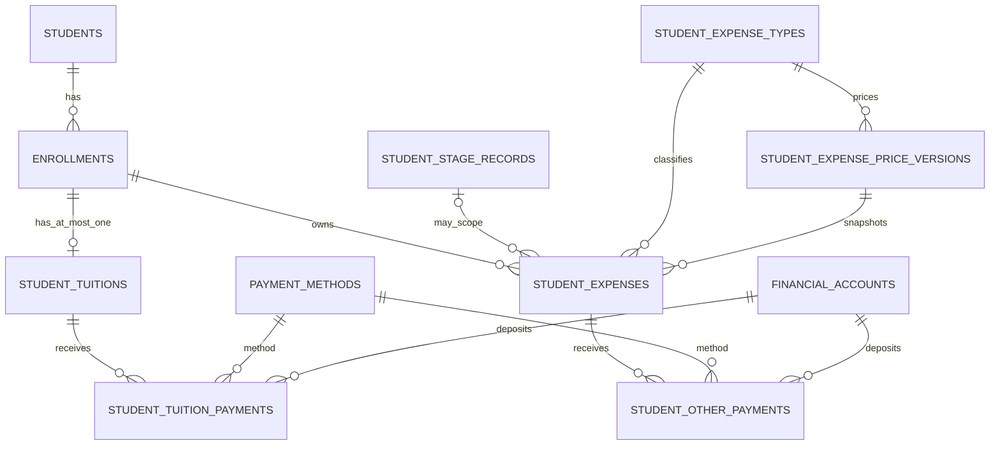

# FIN-001: Enrollment-Based Student Billing & Payment Management

## 1. Objective

Provide Finance staff with an enrollment-scoped workspace for reviewing student charges and recording payments. Staff search by the student's Student ID (`students.student_code`), choose one of that student's enrollments, and manage the financial records attached to that enrollment.

A student can have more than one enrollment. Each enrollment has an independent tuition record, expense records, payment history, and balance. A payment or charge must never be attributed to another enrollment.

This feature provides the enrollment-scoped Finance API and its UI integration on `/billings/student-bill`. The API remains the source of truth for balances, payment history, branch scope, and cash-payment rules.

## 2. Verified Database Design

FIN-001 must use the current tables below. Do not add a student billing, invoice, or payment table.



The direct payment-to-enrollment relationship is transitive through the obligation: a tuition payment belongs to `student_tuition_id`, and an other payment belongs to `student_expense_id`. Services must verify the obligation belongs to the selected enrollment before reading or writing payment data.

| Current table | Relevant structure and behavior |
|---|---|
| `students` | Student identifier is `student_code`; the API's `student_id` search parameter means this value. |
| `enrollments` | Belongs to one student, course, branch, and optional batch. Branch ownership comes from `enrollments.branch_id`. |
| `student_tuitions` | `enrollment_id` is unique, so the current schema supports zero or one tuition record per enrollment, not multiple tuition installments/obligations. Amounts use `decimal(12,2)`. |
| `student_tuition_payments` | Many payments per tuition; stores amount, paid date, payment method, financial account, reference, notes, status, and recorder/verifier IDs. Amount uses `decimal(12,2)`. |
| `student_expense_types` | Expense categories are institute-specific and may be deactivated. |
| `student_expense_price_versions` | Approved historical prices can be scoped by branch, course, and course stage, with effective dates. Amount uses `decimal(12,2)`. |
| `student_expenses` | Stores student, optional direct enrollment, optional stage record, branch, expense type and price version, description, quantity (`decimal(12,3)`), copied unit amount (`decimal(12,2)`), dates, status, and recorder. Existing rows may be linked to an enrollment through `student_stage_record_id` when `enrollment_id` is null. New FIN-001 expenses must set `enrollment_id` directly and derive student and branch from that enrollment. |
| `student_other_payments` | This is the **current** expense-payment table name. It stores many payments per expense. An earlier migration created `student_expense_payments`; a later migration renamed it to `student_other_payments`. Models already map `StudentExpensePayment` to the renamed table. |
| `payment_methods`, `financial_accounts` | Existing collection configuration. Both payment tables reference these records. |

The relationship migrations add foreign keys, including unique `student_tuitions.enrollment_id`, `student_tuition_payments.student_tuition_id`, `student_expenses.enrollment_id`, and `student_other_payments.student_expense_id`. `student_expenses.enrollment_id` remains nullable to support existing stage-linked records; FIN-001 must not change that historical schema contract.

### Existing model relationships

- `Student::enrollments()` is `hasMany(Enrollment)`.
- `Enrollment::tuition()` is `hasOne(StudentTuition)`; `Enrollment::expenses()` is `hasMany(StudentExpense)`.
- `StudentTuition::payments()` is `hasMany(StudentTuitionPayment)`.
- `StudentExpense::payments()` is `hasMany(StudentExpensePayment)`; `StudentExpensePayment` maps to `student_other_payments`.
- `StudentExpense` can also reference `StudentStageRecord`, whose enrollment identifies the owning enrollment for legacy stage charges.

## 3. Current Gaps and Schema Decisions

1. **No student-finance schema migration is required** for the workflow below. Existing tables and relationships hold the needed charge, payment, account, date, and audit data.
2. The current one-tuition-per-enrollment constraint means this feature must display and collect against the existing tuition record. If the institute later needs monthly/term tuition obligations, that is a separate approved database design change; do not work around the unique constraint or add an invoice table here.
3. The billing policy requires single-branch users, multiple-branch users, and superusers. The current `users` schema stores one nullable `branch_id` and `is_super_admin`; there is no user-to-branch pivot. User Control also currently provisions regular accounts for exactly one distinct branch. **Multi-branch access is therefore not represented by the current user schema.** Before FIN-001 is considered complete for multi-branch users, Security must provide an approved source of assigned branch IDs (for example, a user-branch assignment relation) and update account provisioning. Do not infer multi-branch access from arbitrary request input or grant access based on a student's admission branch.
4. The current `student_tuitions` table has no `recorded_by`/`issued_by` column. FIN-001 does not add tuition issuance or bill-status mutation. If issuer-only tuition status changes are added to this feature later, add an approved, auditable issuer source first; the service must enforce issuer-or-superuser policy.
5. Payment tables have a unique `payment_number` but no dedicated idempotency column. FIN-001 must require a client-generated `idempotency_key` for each payment submission and derive the stored unique payment number from the obligation plus that key. Reusing a key with an identical payload returns the same payment; reusing it with different payment data is a validation conflict. This avoids a payment-table migration while providing retry safety.

## 4. Core Workflow

### Step 1: Student search

- Search by exact `student_code` (the UI may label it Student ID).
- Return basic student details and the enrollments the caller is allowed to see.
- Do not expose an inaccessible student's enrollments or finance history. Return the normal not-found response when the student has no enrollment in the caller's permitted branch scope.

### Step 2: Enrollment selection

For every visible enrollment, return:

- Enrollment ID and reference.
- Course, batch, and branch.
- Enrollment date and academic status.
- Financial status calculated from the current obligation and confirmed payment records.

After selection, all billing and payment operations use the selected enrollment ID. Do not combine balances from other enrollments belonging to the same student.

### Step 3: Enrollment billing overview

Return a consolidated summary for this enrollment:

- Tuition gross amount, confirmed amount paid, and outstanding balance.
- Active other-expense gross amount, confirmed amount paid, and outstanding balance.
- Net total obligation after approved waivers, total confirmed paid, and total outstanding.
- The tuition record and itemized other expenses, including their status and payment history.

Cancelled obligations do not count as outstanding obligations. Only confirmed payments reduce balances; pending or rejected payment rows remain visible in history but do not reduce the due amount. Approved waivers reduce the payable amount.

### Step 4: Tuition payment management

Use `student_tuitions` and `student_tuition_payments`:

- Retrieve the single tuition record, if present, for the selected enrollment.
- Record full or partial cash payments; allow multiple receipts until the balance is cleared.
- Select an eligible active cash account for the enrollment's institute and branch.
- Record payment date (default to the server's current time), optional transaction/reference number, and remarks.
- Resolve the active Cash payment method on the server. Do not accept a caller-selected non-cash method in this phase.
- Generate a unique payment receipt/reference number on the server.
- Return the updated balance and complete payment history.

### Step 5: Other student expenses and payments

Use `student_expense_types`, `student_expense_price_versions`, `student_expenses`, and `student_other_payments`:

- Return active expense types and approved prices effective on the issue date and applicable to the selected branch/course. For a stage-specific price, include a `student_stage_record_id` owned by the selected enrollment; stage prices are not available for an enrollment-wide expense.
- Create an expense directly against the selected enrollment. Derive its student and branch from that enrollment; do not accept those ownership IDs from the request.
- Copy the selected approved price into `student_expenses.unit_amount`; later price changes must not alter an issued expense.
- Support quantity, description, issue date, optional due date, and remarks.
- Optionally attach the charge to a stage record belonging to the selected enrollment when using a stage-specific price; the expense must still store the selected enrollment directly.
- Record full or partial cash payments against the selected expense, with the same account, date, reference, remarks, receipt, and idempotency behavior as tuition payments.
- Display complete expense and payment history, including legacy stage-linked expenses when the stage belongs to the selected enrollment.

Examples include examination, registration, certificate, ID card, laboratory/practical, penalty/fine, and other approved expense types.

## 5. Business Rules and Finance Policy

1. Keep all business rules, ownership checks, calculations, and branch enforcement in Finance Services. Controllers only coordinate validated requests and API responses.
2. Use Form Requests for validation. Keep database workflows out of Requests and Controllers.
3. A particular-branch user can access only records for that branch.
4. A multiple-branch user can access only records for explicitly assigned branches. This rule is contingent on Security providing the missing branch-assignment source described in Section 3; until then, the existing single `users.branch_id` scope applies.
5. A superuser (`is_super_admin`) can access all branches.
6. Never use the student's admission branch as a substitute for the selected enrollment's branch.
7. Verify on every operation that the enrollment is in the caller's scope, the tuition or expense belongs to that enrollment, and the enrollment belongs to the searched student where a student is part of the request.
8. New expenses must have a direct `enrollment_id` equal to the selected enrollment, with the same `student_id` and `branch_id` as that enrollment.
9. Payments must be attached to an obligation under the selected enrollment. Never write a direct payment for a different enrollment's obligation.
10. Reject zero/negative amounts and any amount greater than the current outstanding balance.
11. Use database transactions and lock the individual tuition/expense row before calculating and accepting a payment, preventing concurrent overpayment.
12. Require idempotency keys for payment writes. An exact retry cannot create another payment row; a reused key with a different payload must fail.
13. Use decimal database values and integer minor units for arithmetic; do not use floating point for balance comparisons.
14. Do not add new tables or columns for FIN-001 unless a separately approved schema change is necessary. The multi-branch user-scope prerequisite is the known exception requiring a Security decision before that policy can be fully supported.
15. No status-change endpoint is part of FIN-001. Any future bill-status update must follow the billing policy: only the bill issuer or a superuser may change the status, enforced in the Finance service. The current tuition schema does not record its issuer, so issuer-only tuition status changes require a prior schema/audit decision.
16. Cash is the only supported payment method in this phase. Mobile banking, cards, bank transfers, and cheques remain out of scope until separately approved.

## 6. API Requirements

All endpoints follow `/api/v1`, use authenticated session middleware, and return Laravel-appropriate status codes (200, 201, 401, 404, 422). Implement route declarations in the owning module and keep any cross-module controller/service references consistent with existing conventions.

| Method and endpoint | Purpose |
|---|---|
| `GET /api/v1/student-payments?student_id={student_code}&page={page}&per_page={count}` | Paginated charge register across the caller's permitted branch scope. `student_id` is optional and filters by exact Student ID. |
| `GET /api/v1/students/search?student_id={student_code}` | Exact student lookup and visible enrollments. Register the static route before `students/{studentCode}`. |
| `GET /api/v1/students/{studentCode}/enrollments` | List the student's visible enrollments. |
| `GET /api/v1/enrollments/{enrollment}/billing` | Enrollment-scoped overview and totals. |
| `GET /api/v1/enrollments/{enrollment}/tuition` | Return the enrollment's one tuition record and its payments, or 404 when none exists. |
| `GET /api/v1/enrollments/{enrollment}/payment-options` | Return active Cash method and branch-compatible active cash accounts. |
| `POST /api/v1/enrollments/{enrollment}/tuition/{tuition}/payments` | Record a cash tuition payment; validate that tuition belongs to enrollment. |
| `GET /api/v1/enrollments/{enrollment}/expenses/options?issued_on={date}&student_stage_record_id={id}` | Return approved effective prices for the date and optional enrollment-owned stage. |
| `GET /api/v1/enrollments/{enrollment}/expenses` | List direct and legacy stage-linked expenses for this enrollment. |
| `POST /api/v1/enrollments/{enrollment}/expenses` | Create an enrollment-owned expense from an applicable approved price. |
| `GET /api/v1/enrollments/{enrollment}/expenses/{expense}` | Return one expense and its payment history after ownership validation. |
| `POST /api/v1/enrollments/{enrollment}/expenses/{expense}/payments` | Record a cash expense payment after ownership validation. |
| `GET /api/v1/enrollments/{enrollment}/payments` | Combined tuition and expense payment history for this enrollment only. |

Payment request data:

```json
{
  "amount": "250.00",
  "financial_account_id": 12,
  "idempotency_key": "client-generated-unique-key",
  "paid_at": "2026-11-25T10:00:00+06:00",
  "transaction_reference": "optional-reference",
  "notes": "optional remarks"
}
```

`paid_at`, `transaction_reference`, and `notes` are optional; `paid_at` defaults to server time. `payment_method_id` is deliberately omitted while Cash is the only allowed method. The service selects the configured active Cash method for the enrollment's institute.
An exact idempotent payment replay returns HTTP 200 with the original payment; a new payment returns HTTP 201.

Expense creation request data:

```json
{
  "student_expense_type_id": 4,
  "price_version_id": 18,
  "student_stage_record_id": 52,
  "quantity": "1.000",
  "description": "Optional description override",
  "issued_on": "2026-11-25",
  "due_on": null,
  "notes": "Optional remarks"
}
```

The service sets `student_id`, `enrollment_id`, `branch_id`, copied unit price, status, and recorder from trusted records and the signed-in user.

## 7. Testing Requirements

Write Pest feature tests for:

- Exact Student ID lookup, multiple enrollments, and branch-scoped results.
- Paginated charge register, optional exact Student ID filter, and superuser cross-branch scope.
- Single-branch and superuser access; multi-branch access once Security provides assigned branch IDs.
- Enrollment-specific overview totals and isolation between two enrollments for one student.
- Missing tuition, existing tuition payment history, and multiple partial payments.
- Active Cash account/method selection and rejection of an account from another branch/institute or a non-cash account.
- Applicable approved price filtering, stale/unapproved/wrong-scope prices, and copied historical price preservation.
- Expense creation assigning the enrollment's student and branch, plus legacy stage-linked expense retrieval.
- Expense full/partial/multiple payments and both payment histories.
- Zero, negative, and over-balance payments; wrong-enrollment tuition/expense/payment paths.
- Idempotent same-key retry, same key with changed payload, and a new key creating a distinct receipt.
- Transaction rollback on failed payment creation and row-lock/concurrent overpayment behavior where the test database supports it.
- Correct Laravel API status codes and unauthenticated access rejection.

Never weaken an existing failing test. Do not use the production database. Run targeted Finance tests, affected Academy financial tests, and the full test suite; report any pre-existing failures separately. Do not run migrations manually.

## 8. Implementation Boundaries and Delivery

- Implement the backend API and connect `/billings/student-bill` to its enrollment-scoped endpoints.
- Follow `Routes → Form Request → Controller → Finance Service → Model/Database`.
- Keep policy and financial integrity rules in Finance Services, not controllers or requests.
- Do not create a new bill, invoice, or payment table.
- Before coding, confirm the required Security decision for multi-branch assignments and the status of any necessary migration. Do not implement guessed access rules.
- Deliver a verification summary with changed files, Pest files/commands/results, known untested cases, outstanding schema/security dependencies, and a manual API acceptance checklist.
